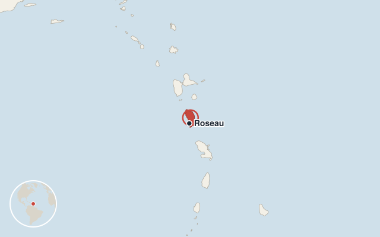
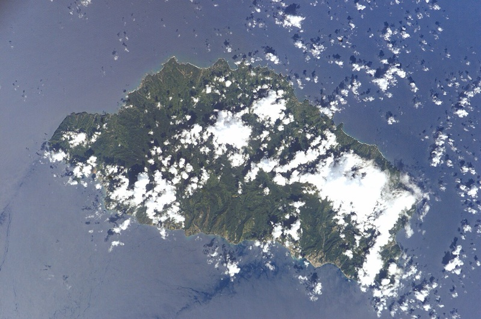

---
id    = "f0dcf107-2b01-5130-8165-9ccc10af14b1"
model = "Basic"
tags  = ["caribbean", "north_america", "sovereign_state", "country"]
---

## Front

<b>Roseau</b> is the capital of which country or territory?

## Back

<b>Dominica</b>

## Extra

<i>Photo: NASA, Public domain, via Wikimedia Commons</i>

About 74,700 people (2023) in 751 km² Independent since 1978

The youngest island in the Lesser Antilles, still being formed by volcanic activity. Its Boiling Lake is the world's second-largest hot spring.

<a href="https://en.wikipedia.org/wiki/Dominica">Dominica on Wikipedia</a> <a href="https://en.wikipedia.org/wiki/Roseau">Roseau on Wikipedia</a>
