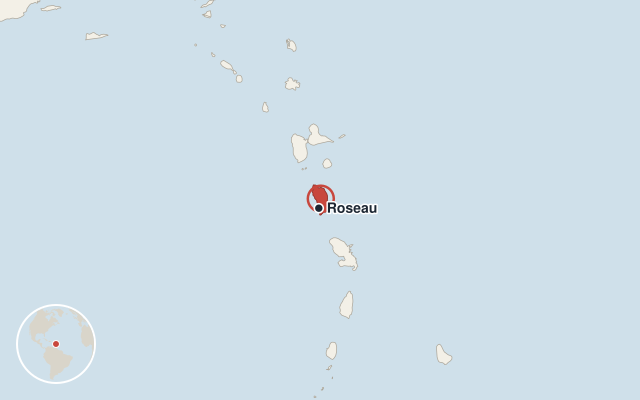

---
id    = "a9b7d8fc-923b-528d-81ef-3c20d8f1e502"
model = "Basic"
tags  = ["caribbean", "north_america", "sovereign_state", "flag"]
---

## Front

Whose flag is this?

## Back

<b>Dominica</b>

## Extra

<a href="https://en.wikipedia.org/wiki/Flag_of_Dominica">Flag of Dominica on Wikipedia</a> <a href="https://en.wikipedia.org/wiki/Dominica">Dominica on Wikipedia</a>
