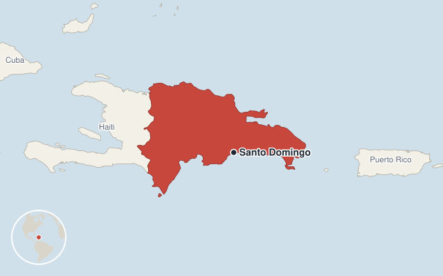

---
id    = "cf497829-0a5d-564d-8bc4-3fcda8864eda"
model = "Basic"
tags  = ["caribbean", "north_america", "sovereign_state", "capital"]
---

## Front

What is the capital of <b>Dominican Republic</b>?

## Back

<b>Santo Domingo</b>

## Extra

<a href="https://en.wikipedia.org/wiki/Santo_Domingo">Santo Domingo on Wikipedia</a> <a href="https://en.wikipedia.org/wiki/Dominican_Republic">Dominican Republic on Wikipedia</a>
