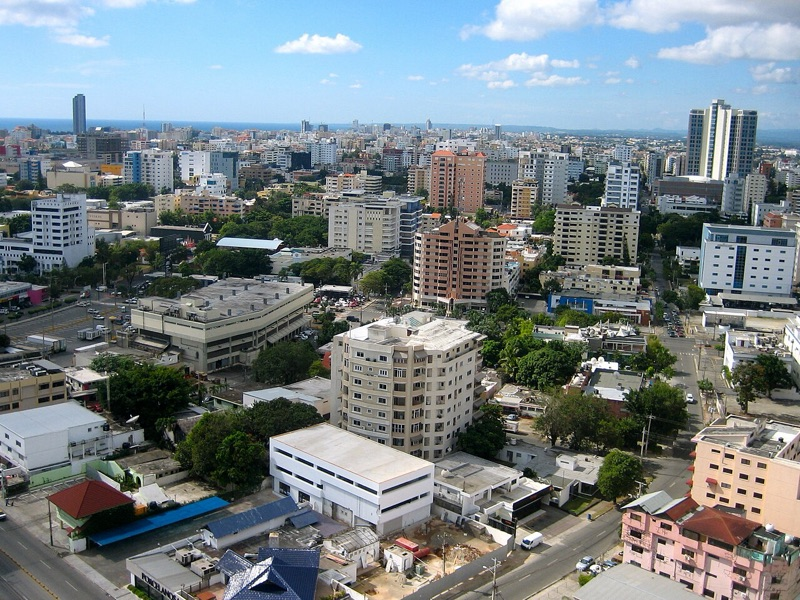

---
id    = "cf497829-0a5d-564d-8bc4-3fcda8864eda"
model = "Basic"
tags  = ["caribbean", "north_america", "sovereign_state", "capital"]
---

## Front

What is the capital of <b>Dominican Republic</b>?

## Back

<b>Santo Domingo</b>

## Extra

<i>Photo: Jjc09, Public domain, via Wikimedia Commons</i>

About 1.03 million people in the city centre (2022) Greater Santo Domingo has about 4.3 million

Founded in 1496 by Spain, it is the oldest continuously inhabited European settlement in the Americas. From 1936 to 1961 it was called Ciudad Trujillo, after the dictator who named it after himself.

<a href="https://en.wikipedia.org/wiki/Santo_Domingo">Santo Domingo on Wikipedia</a> <a href="https://en.wikipedia.org/wiki/Dominican_Republic">Dominican Republic on Wikipedia</a>
