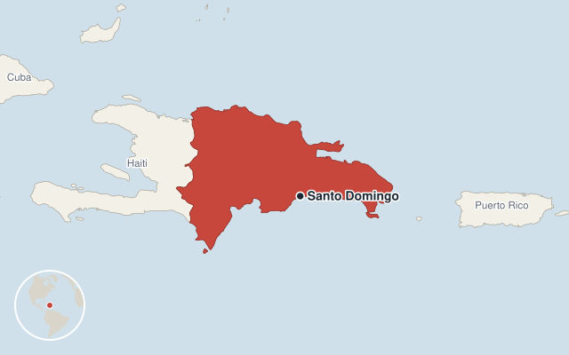

---
id    = "76b8cfd7-4934-571c-976c-063dbe3b4bfa"
model = "Basic"
tags  = ["caribbean", "north_america", "sovereign_state", "country"]
---

## Front

<b>Santo Domingo</b> is the capital of which country or territory?

## Back

<b>Dominican Republic</b>

## Extra

<a href="https://en.wikipedia.org/wiki/Dominican_Republic">Dominican Republic on Wikipedia</a> <a href="https://en.wikipedia.org/wiki/Santo_Domingo">Santo Domingo on Wikipedia</a>
