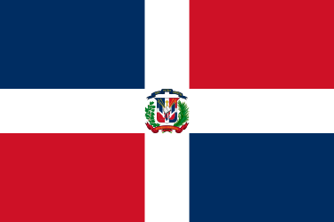
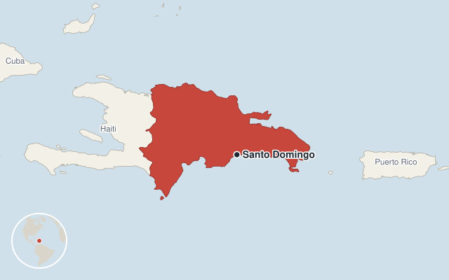

---
id    = "1dca48ff-ad5c-52f0-829c-e2b65011cfe9"
model = "Basic"
tags  = ["caribbean", "north_america", "sovereign_state", "flag"]
---

## Front

Whose flag is this?

## Back

<b>Dominican Republic</b>

## Extra

Adopted on 6 November 1862

Blue stands for liberty, white for salvation and red for the blood of heroes. Juan Pablo Duarte designed the flag.

<a href="https://en.wikipedia.org/wiki/Flag_of_the_Dominican_Republic">Flag of the Dominican Republic on Wikipedia</a> <a href="https://en.wikipedia.org/wiki/Dominican_Republic">Dominican Republic on Wikipedia</a>
