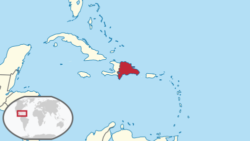
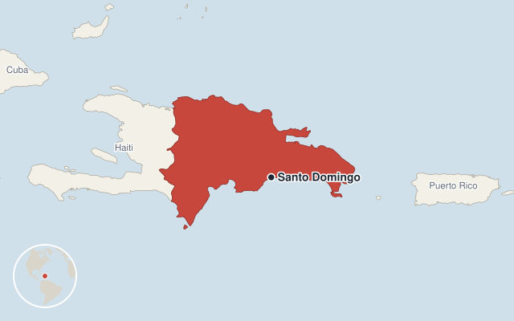

---
id    = "c553b53a-a64a-5739-99d1-f4585abff648"
model = "Basic"
tags  = ["caribbean", "north_america", "sovereign_state", "map"]
---

## Front

What is highlighted on this map?

## Back

<b>Dominican Republic</b>

## Extra

<a href="https://en.wikipedia.org/wiki/Dominican_Republic">Dominican Republic on Wikipedia</a>
