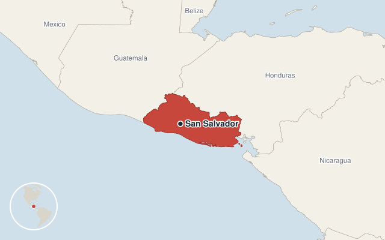

---
id    = "10110d4a-e3aa-54c3-8fd1-087123a318e0"
model = "Basic"
tags  = ["north_america", "sovereign_state", "capital"]
---

## Front

What is the capital of <b>El Salvador</b>?

## Back

<b>San Salvador</b>

## Extra

About 331,000 people in the city (2024) 670 m up, among volcanoes in the highlands

Gonzalo de Alvarado founded a mission named San Salvador in 1525. The name likely refers to the Transfiguration of Jesus, celebrated on 6 August. The city is prone to earthquakes.

<a href="https://en.wikipedia.org/wiki/San_Salvador">San Salvador on Wikipedia</a> <a href="https://en.wikipedia.org/wiki/El_Salvador">El Salvador on Wikipedia</a>
