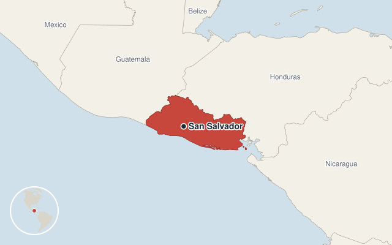

---
id    = "df4834a9-f435-55b1-9e67-3721e1192ba3"
model = "Basic"
tags  = ["north_america", "sovereign_state", "country"]
---

## Front

<b>San Salvador</b> is the capital of which country or territory?

## Back

<b>El Salvador</b>

## Extra

<a href="https://en.wikipedia.org/wiki/El_Salvador">El Salvador on Wikipedia</a> <a href="https://en.wikipedia.org/wiki/San_Salvador">San Salvador on Wikipedia</a>
