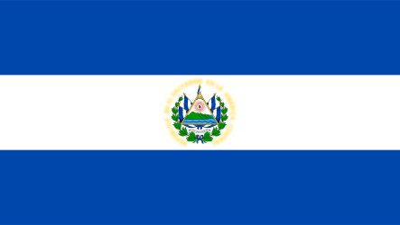
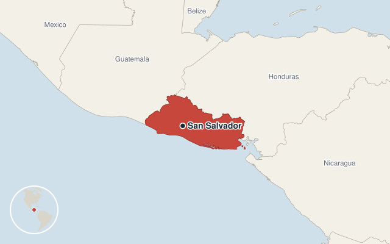

---
id    = "9e3a0f6b-2b99-54b0-95c4-ce5e65011604"
model = "Basic"
tags  = ["north_america", "sovereign_state", "flag"]
---

## Front

Whose flag is this?

## Back

<b>El Salvador</b>

## Extra

Similar flags: Nicaragua (different coat of arms, slightly lighter blue)

<a href="https://en.wikipedia.org/wiki/Flag_of_El_Salvador">Flag of El Salvador on Wikipedia</a> <a href="https://en.wikipedia.org/wiki/El_Salvador">El Salvador on Wikipedia</a>
