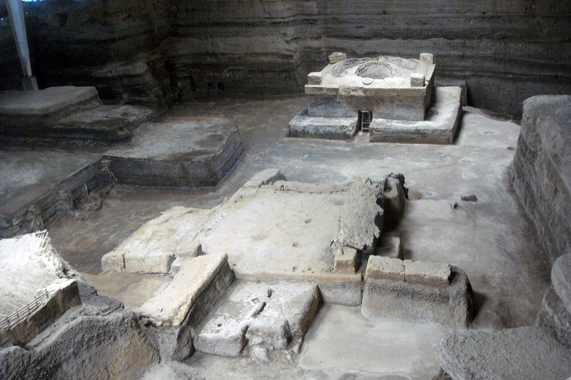

---
id    = "84770723-cb47-5854-9d02-e682a4ad8aa5"
model = "Basic"
tags  = ["north_america", "sovereign_state", "map"]
---

## Front

What is highlighted on this map?

## Back

<b>El Salvador</b>

## Extra

<i>Photo: Mariordo (Mario Roberto Durán Ortiz), CC BY-SA 3.0, via Wikimedia Commons</i>

Borders Guatemala and Honduras Highest point Cerro El Pital

It lies along the Pacific coast, with Guatemala to the northwest and Honduras to the northeast. Volcanic ash has blanketed possible archaeological sites.

<a href="https://en.wikipedia.org/wiki/El_Salvador">El Salvador on Wikipedia</a>
