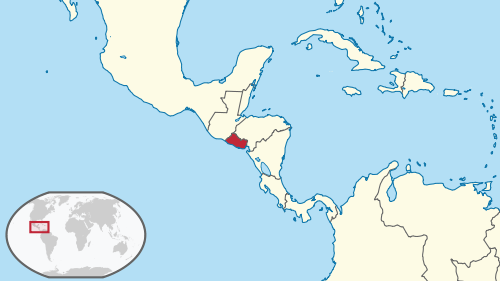
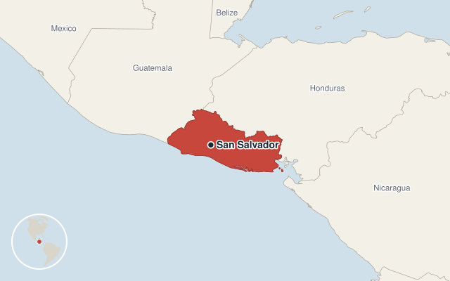

---
id    = "84770723-cb47-5854-9d02-e682a4ad8aa5"
model = "Basic"
tags  = ["north_america", "sovereign_state", "map"]
---

## Front

What is highlighted on this map?

## Back

<b>El Salvador</b>

## Extra

<a href="https://en.wikipedia.org/wiki/El_Salvador">El Salvador on Wikipedia</a>
