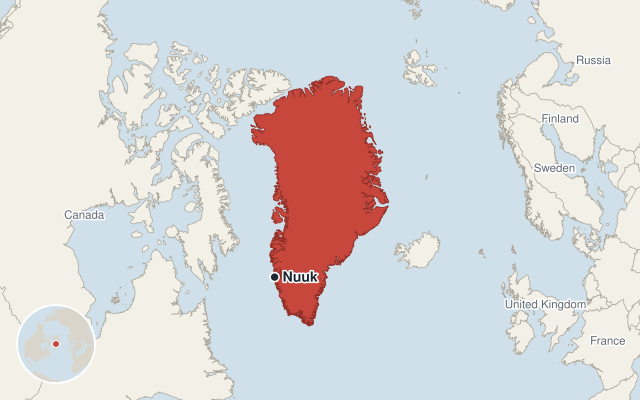
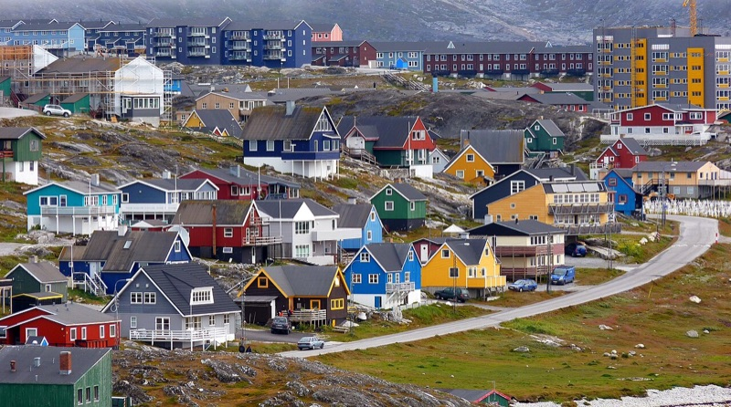

---
id    = "330e61d2-278d-51ca-8327-58fc1bd9fce2"
model = "Basic"
tags  = ["north_america", "capital"]
---

## Front

What is the capital of <b>Greenland</b>?

## Back

<b>Nuuk</b>

## Extra

<i>Photo: patano, patano, via Wikimedia Commons</i>

About 20,100 people (January 2025) Formerly called Godthåb in Danish

One of the smallest capitals in the world by population, yet home to more than a third of Greenland's people. Hans Egede founded it in 1728, after moving from the earlier Hope Colony.

Constituent country in the Kingdom of Denmark.

<a href="https://en.wikipedia.org/wiki/Nuuk">Nuuk on Wikipedia</a> <a href="https://en.wikipedia.org/wiki/Greenland">Greenland on Wikipedia</a>
