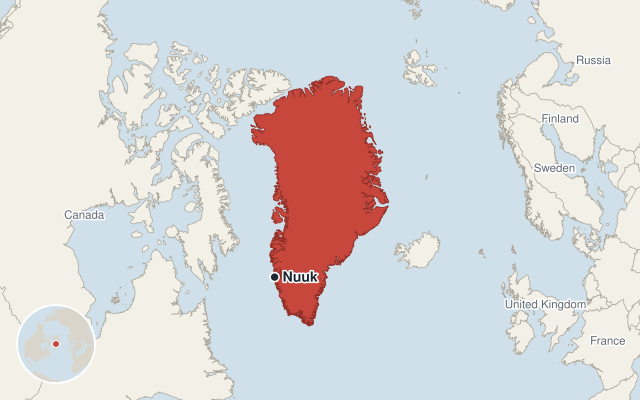

---
id    = "9dfcfcb0-9a0d-5471-86a7-0549ee00b665"
model = "Basic"
tags  = ["north_america", "country"]
---

## Front

<b>Nuuk</b> is the capital of which country or territory?

## Back

<b>Greenland</b>

## Extra

About 56,500 people (2025) Highest point Gunnbjørn Fjeld

The world's largest island. Its citizens are citizens of Denmark and so of the EU, though Greenland itself is not part of the EU.

Constituent country in the Kingdom of Denmark.

<a href="https://en.wikipedia.org/wiki/Greenland">Greenland on Wikipedia</a> <a href="https://en.wikipedia.org/wiki/Nuuk">Nuuk on Wikipedia</a>
