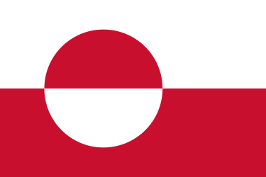
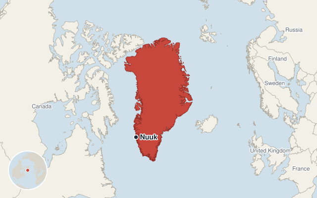

---
id    = "06aacc5c-2611-54c1-be18-13e51694325c"
model = "Basic"
tags  = ["north_america", "flag"]
---

## Front

Whose flag is this?

## Back

<b>Greenland</b>

## Extra

Constituent country in the Kingdom of Denmark.

<a href="https://en.wikipedia.org/wiki/Flag_of_Greenland">Flag of Greenland on Wikipedia</a> <a href="https://en.wikipedia.org/wiki/Greenland">Greenland on Wikipedia</a>
