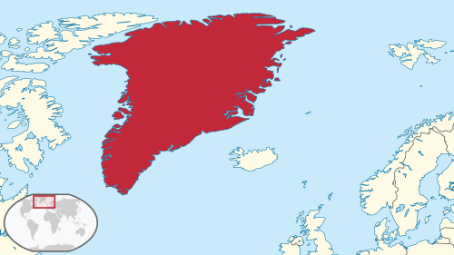
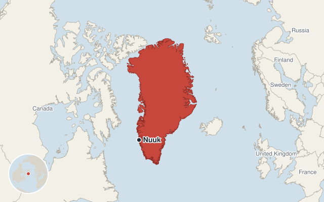

---
id    = "da53ae57-23fd-578c-a655-1124db0cafa1"
model = "Basic"
tags  = ["north_america", "map"]
---

## Front

What is highlighted on this map?

## Back

<b>Greenland</b>

## Extra

Constituent country in the Kingdom of Denmark.

<a href="https://en.wikipedia.org/wiki/Greenland">Greenland on Wikipedia</a>
