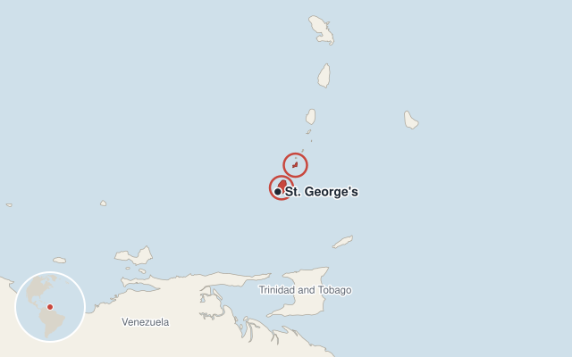
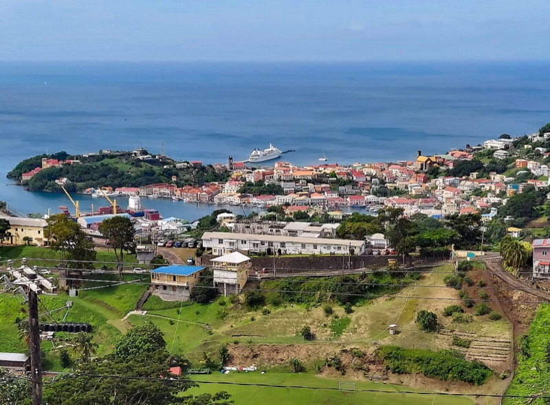

---
id    = "b39163f8-9d3b-56e5-adef-f14719bbc5ae"
model = "Basic"
tags  = ["caribbean", "north_america", "sovereign_state", "capital"]
---

## Front

What is the capital of <b>Grenada</b>?

## Back

<b>St. George's</b>

## Extra

<i>Photo: P. Hughes, CC BY-SA 4.0, via Wikimedia Commons</i>

Grenada's main port On the southwest coast

Surrounded by the hillside of an old volcano crater, it sits on a horseshoe-shaped harbour. The French founded it in 1650, when Jacques Dyel du Parquet, governor of Martinique, colonised 'La Grenade'.

<a href="https://en.wikipedia.org/wiki/St._George's,_Grenada">St. George's, Grenada on Wikipedia</a> <a href="https://en.wikipedia.org/wiki/Grenada">Grenada on Wikipedia</a>
