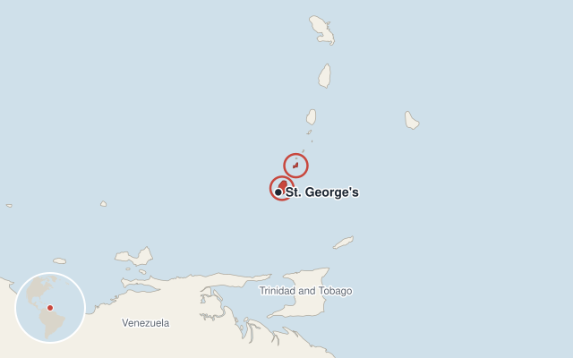

---
id    = "3ed61416-3441-53ec-abc3-2f17cc6902ab"
model = "Basic"
tags  = ["caribbean", "north_america", "sovereign_state", "country"]
---

## Front

<b>St. George's</b> is the capital of which country or territory?

## Back

<b>Grenada</b>

## Extra

<a href="https://en.wikipedia.org/wiki/Grenada">Grenada on Wikipedia</a> <a href="https://en.wikipedia.org/wiki/St._George's,_Grenada">St. George's, Grenada on Wikipedia</a>
