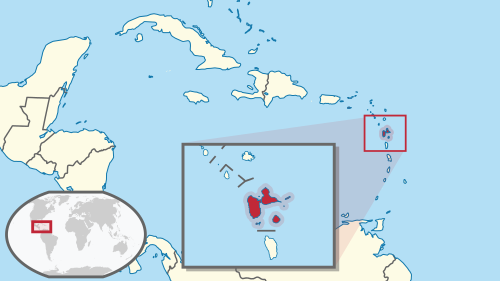

---
id    = "ccdbd722-8f5f-5660-9b55-01c9f1c83979"
model = "Basic"
tags  = ["caribbean", "north_america", "map"]
---

## Front

What is highlighted on this map?

## Back

<b>Guadeloupe</b>

## Extra

Overseas department of France.
