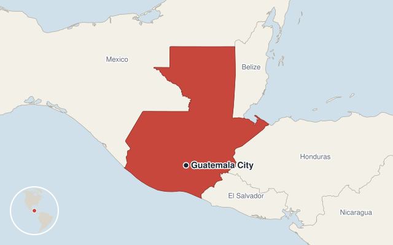

---
id    = "0f80156a-0708-532c-baba-af5782ae4326"
model = "Basic"
tags  = ["north_america", "sovereign_state", "capital"]
---

## Front

What is the capital of <b>Guatemala</b>?

## Back

<b>Guatemala City</b>

## Extra

About 995,000 people in the city (2025) 1,500 m up, in the Valle de la Ermita

Nicknamed Guate. Its metropolitan area is the largest in Central America.

<a href="https://en.wikipedia.org/wiki/Guatemala_City">Guatemala City on Wikipedia</a> <a href="https://en.wikipedia.org/wiki/Guatemala">Guatemala on Wikipedia</a>
