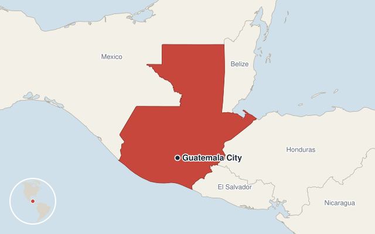
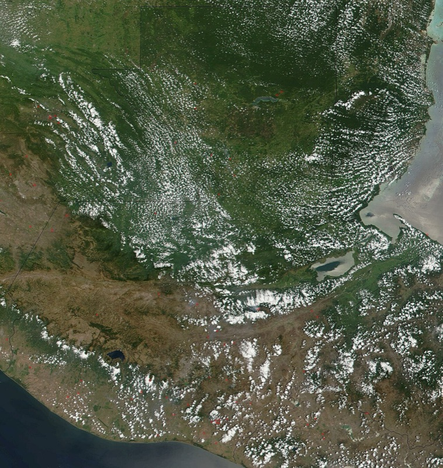

---
id    = "71291dd1-66f1-5898-8388-3a60792e64a2"
model = "Basic"
tags  = ["north_america", "sovereign_state", "country"]
---

## Front

<b>Guatemala City</b> is the capital of which country or territory?

## Back

<b>Guatemala</b>

## Extra

<i>Photo: Jacques Descloitres, MODIS Land Rapid Response Team, NASA/GSFC, Public domain, via Wikimedia Commons</i>

About 17.3 million people (2018) in 108,889 km²

The territory hosted the core of the Maya civilization, which spread across Mesoamerica. The Spanish conquered most of it in the 16th century.

<a href="https://en.wikipedia.org/wiki/Guatemala">Guatemala on Wikipedia</a> <a href="https://en.wikipedia.org/wiki/Guatemala_City">Guatemala City on Wikipedia</a>
