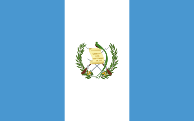
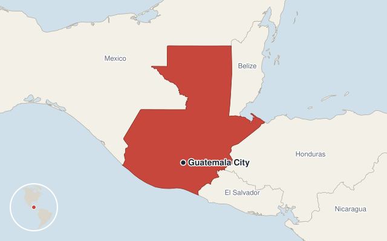

---
id    = "c0f68749-65d3-5521-ad61-c68033fe23ad"
model = "Basic"
tags  = ["north_america", "sovereign_state", "flag"]
---

## Front

Whose flag is this?

## Back

<b>Guatemala</b>

## Extra

Adopted on 17 August 1871

Sky blue and white, as in the flag of the former Federal Republic of Central America. The blue stripes stand for strength, justice, truth and loyalty, and the white for purity, integrity, firmness and light.

<a href="https://en.wikipedia.org/wiki/Flag_of_Guatemala">Flag of Guatemala on Wikipedia</a> <a href="https://en.wikipedia.org/wiki/Guatemala">Guatemala on Wikipedia</a>
