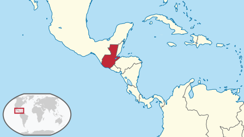
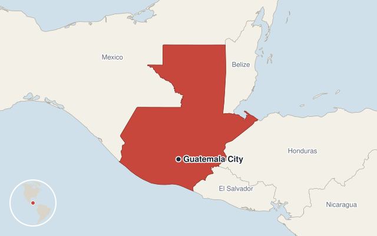

---
id    = "d42c7a79-a4d0-54dc-bf7b-5ed39c158576"
model = "Basic"
tags  = ["north_america", "sovereign_state", "map"]
---

## Front

What is highlighted on this map?

## Back

<b>Guatemala</b>

## Extra

<a href="https://en.wikipedia.org/wiki/Guatemala">Guatemala on Wikipedia</a>
