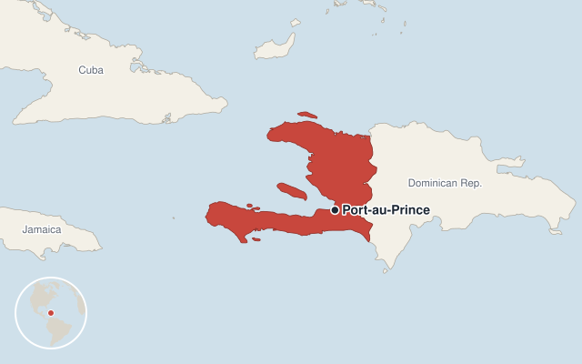

---
id    = "b1a0b286-e997-5da4-9ec9-107d721463e3"
model = "Basic"
tags  = ["caribbean", "north_america", "sovereign_state", "capital"]
---

## Front

What is the capital of <b>Haiti</b>?

## Back

<b>Port-au-Prince</b>

## Extra

<a href="https://en.wikipedia.org/wiki/Port-au-Prince">Port-au-Prince on Wikipedia</a> <a href="https://en.wikipedia.org/wiki/Haiti">Haiti on Wikipedia</a>
