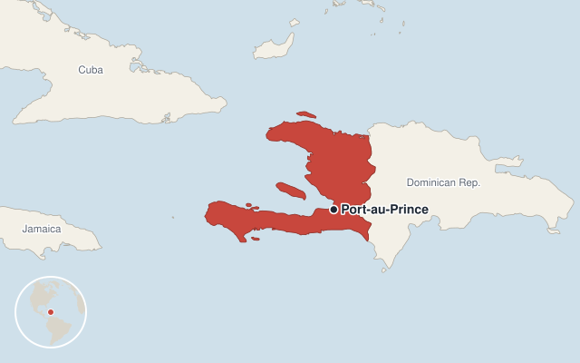
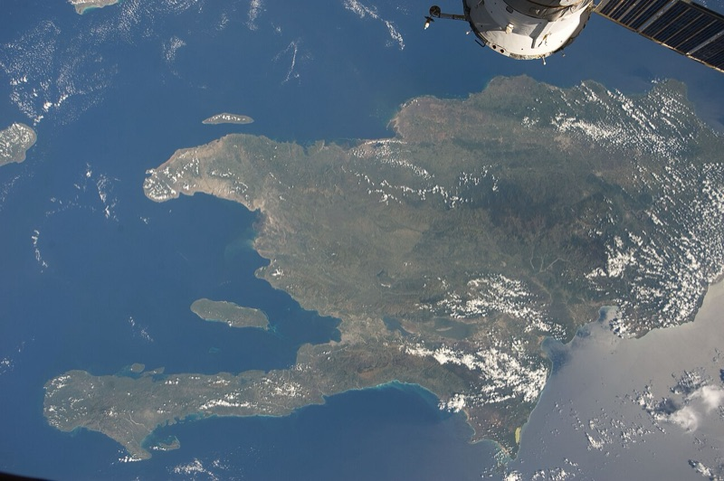

---
id    = "faa8e96c-6a06-5843-9124-8fcbcfd52724"
model = "Basic"
tags  = ["caribbean", "north_america", "sovereign_state", "country"]
---

## Front

<b>Port-au-Prince</b> is the capital of which country or territory?

## Back

<b>Haiti</b>

## Extra

<i>Photo: Earth Science and Remote Sensing Unit, Lyndon B. Johnson Space Center, Public domain, via Wikimedia Commons</i>

About 11 million people (2017) in 27,750 km²

The Haitian Revolution of 1791 to 1804 made it the first country in the Americas to officially abolish slavery, and the only country in history established by a slave revolt.

<a href="https://en.wikipedia.org/wiki/Haiti">Haiti on Wikipedia</a> <a href="https://en.wikipedia.org/wiki/Port-au-Prince">Port-au-Prince on Wikipedia</a>
