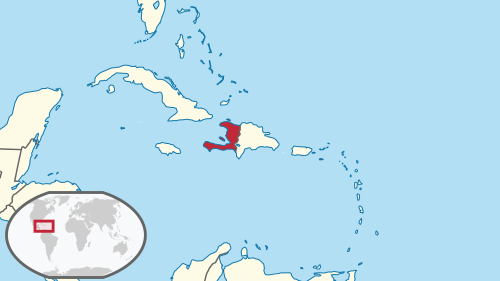
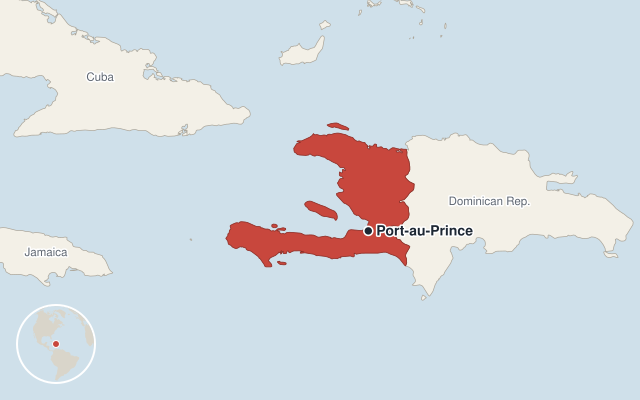

---
id    = "a0c17f3d-0edc-522b-a244-15068fe9a624"
model = "Basic"
tags  = ["caribbean", "north_america", "sovereign_state", "map"]
---

## Front

What is highlighted on this map?

## Back

<b>Haiti</b>

## Extra

Shares Hispaniola with the Dominican Republic, to the east Highest point Peak la Selle

It occupies the western side of Hispaniola, east of Cuba and Jamaica, and is the third-largest country in the Caribbean by area.

<a href="https://en.wikipedia.org/wiki/Haiti">Haiti on Wikipedia</a>
