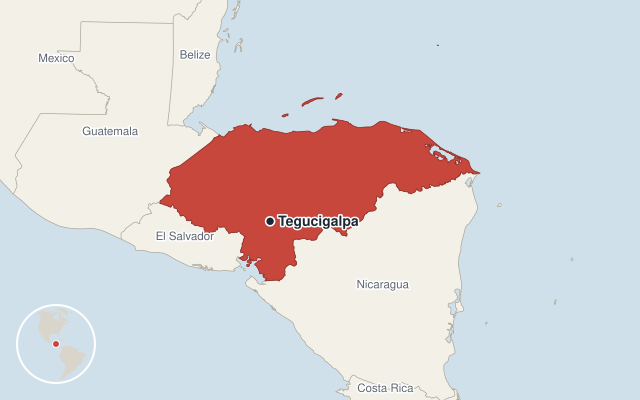

---
id    = "f7f8e464-2657-5aec-a584-f7fc7792c153"
model = "Basic"
tags  = ["north_america", "sovereign_state", "capital"]
---

## Front

What is the capital of <b>Honduras</b>?

## Back

<b>Tegucigalpa</b>

## Extra

<a href="https://en.wikipedia.org/wiki/Tegucigalpa">Tegucigalpa on Wikipedia</a> <a href="https://en.wikipedia.org/wiki/Honduras">Honduras on Wikipedia</a>
