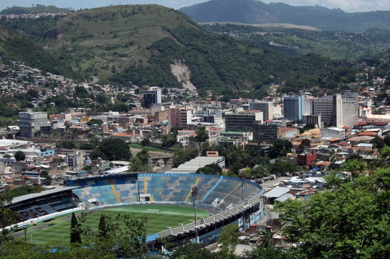

---
id    = "f7f8e464-2657-5aec-a584-f7fc7792c153"
model = "Basic"
tags  = ["north_america", "sovereign_state", "capital"]
---

## Front

What is the capital of <b>Honduras</b>?

## Back

<b>Tegucigalpa</b>

## Extra

<i>Photo: Luis Alfredo Romero, CC BY-SA 4.0, via Wikimedia Commons</i>

About 851,000 people (2025) 990 m up, in the southern-central highlands

Claimed by Spain in 1578, it became the capital in 1880, when President Marco Aurelio Soto moved the seat of government from Comayagua. Sister city Comayagüela forms the Central District with it.

<a href="https://en.wikipedia.org/wiki/Tegucigalpa">Tegucigalpa on Wikipedia</a> <a href="https://en.wikipedia.org/wiki/Honduras">Honduras on Wikipedia</a>
