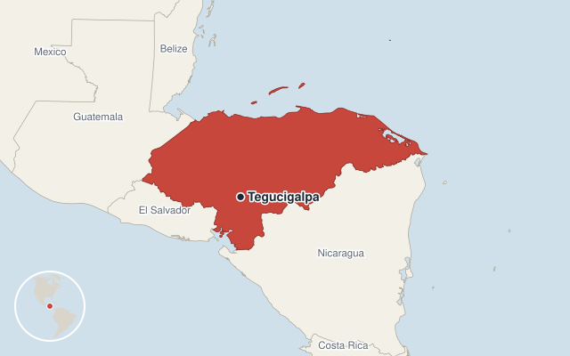

---
id    = "fb7e1b14-8fc5-575c-b6a5-f2b66ea31a37"
model = "Basic"
tags  = ["north_america", "sovereign_state", "country"]
---

## Front

<b>Tegucigalpa</b> is the capital of which country or territory?

## Back

<b>Honduras</b>

## Extra

<a href="https://en.wikipedia.org/wiki/Honduras">Honduras on Wikipedia</a> <a href="https://en.wikipedia.org/wiki/Tegucigalpa">Tegucigalpa on Wikipedia</a>
