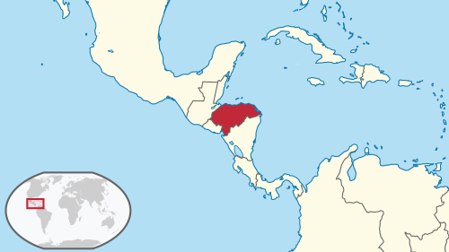
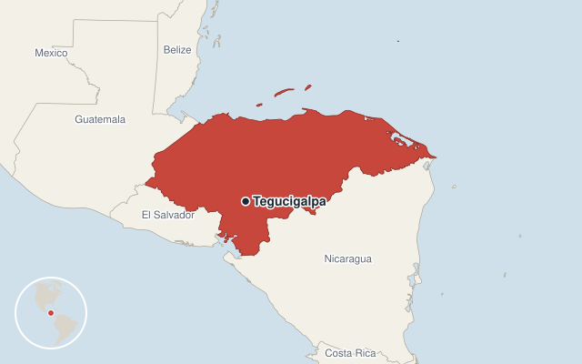

---
id    = "ed31df29-0c14-58be-ac46-35cdf7fb5b78"
model = "Basic"
tags  = ["north_america", "sovereign_state", "map"]
---

## Front

What is highlighted on this map?

## Back

<b>Honduras</b>

## Extra

Borders Guatemala, El Salvador and Nicaragua Highest point Cerro Las Minas

It reaches the Pacific at the Gulf of Fonseca and the Caribbean Sea at the Gulf of Honduras. In 1960 the northern Mosquito Coast was transferred from Nicaragua to Honduras.

<a href="https://en.wikipedia.org/wiki/Honduras">Honduras on Wikipedia</a>
