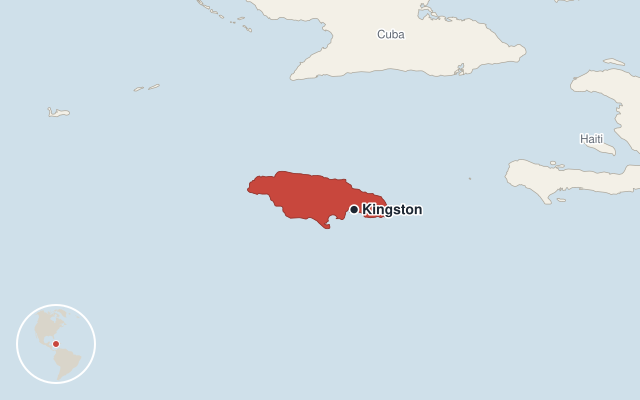

---
id    = "75dc00e9-b2c8-5260-8e1b-6a0f6e4cecb3"
model = "Basic"
tags  = ["caribbean", "north_america", "sovereign_state", "capital"]
---

## Front

What is the capital of <b>Jamaica</b>?

## Back

<b>Kingston</b>

## Extra

About 938,000 people (2025) On the southeastern coast, facing a natural harbour

The Palisadoes, a long sand spit, protects the harbour and links Port Royal and the airport to the rest of the island. It is the largest English-speaking city south of the United States in the Western Hemisphere.

<a href="https://en.wikipedia.org/wiki/Kingston,_Jamaica">Kingston, Jamaica on Wikipedia</a> <a href="https://en.wikipedia.org/wiki/Jamaica">Jamaica on Wikipedia</a>
