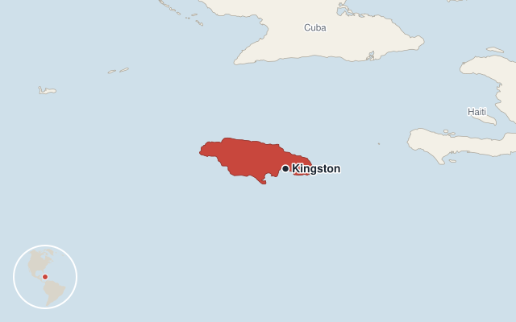

---
id    = "5cfab9fb-dbbb-574b-b9c9-827e4ea80646"
model = "Basic"
tags  = ["caribbean", "north_america", "sovereign_state", "country"]
---

## Front

<b>Kingston</b> is the capital of which country or territory?

## Back

<b>Jamaica</b>

## Extra

<i>Photo: Jacques Descloitres, MODIS Land Rapid Response Team, NASA/GSFC, Public domain, via Wikimedia Commons</i>

About 2.7 million people (2019) in 10,992 km²

The third-largest island in the Greater Antilles and the Caribbean, after Cuba and Hispaniola.

<a href="https://en.wikipedia.org/wiki/Jamaica">Jamaica on Wikipedia</a> <a href="https://en.wikipedia.org/wiki/Kingston,_Jamaica">Kingston, Jamaica on Wikipedia</a>
