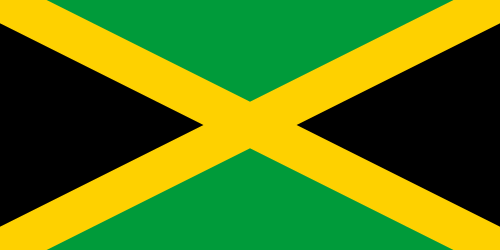
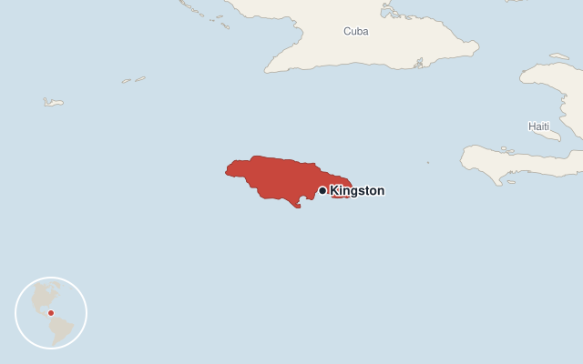

---
id    = "d7850c55-d6c3-5e77-9570-256e774002ce"
model = "Basic"
tags  = ["caribbean", "north_america", "sovereign_state", "flag"]
---

## Front

Whose flag is this?

## Back

<b>Jamaica</b>

## Extra

<a href="https://en.wikipedia.org/wiki/Flag_of_Jamaica">Flag of Jamaica on Wikipedia</a> <a href="https://en.wikipedia.org/wiki/Jamaica">Jamaica on Wikipedia</a>
