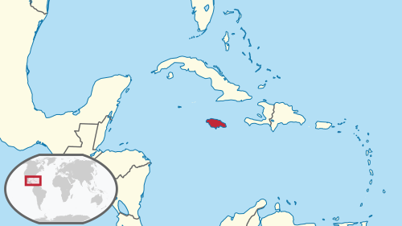
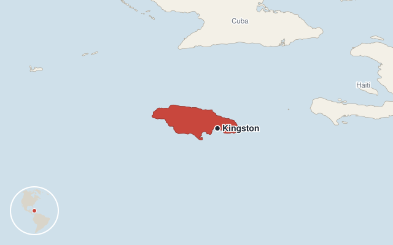

---
id    = "bf63cc78-3c74-538b-a278-b41f169a32ed"
model = "Basic"
tags  = ["caribbean", "north_america", "sovereign_state", "map"]
---

## Front

What is highlighted on this map?

## Back

<b>Jamaica</b>

## Extra

<i>Photo: Jacques Descloitres, MODIS Land Rapid Response Team, NASA/GSFC, Public domain, via Wikimedia Commons</i>

About 145 km south of Cuba Highest point Blue Mountain Peak

It lies 191 km west of Hispaniola and 215 km southeast of the Cayman Islands.

<a href="https://en.wikipedia.org/wiki/Jamaica">Jamaica on Wikipedia</a>
