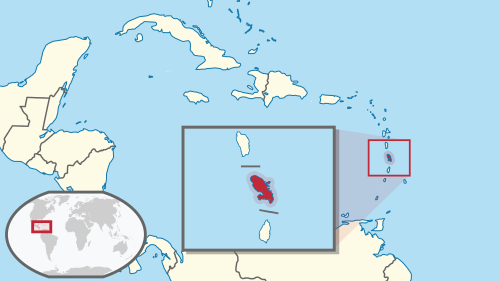

---
id    = "47bf6661-e0e9-5f62-88d3-331929e72028"
model = "Basic"
tags  = ["caribbean", "north_america", "map"]
---

## Front

What is highlighted on this map?

## Back

<b>Martinique</b>

## Extra

Overseas department of France.
