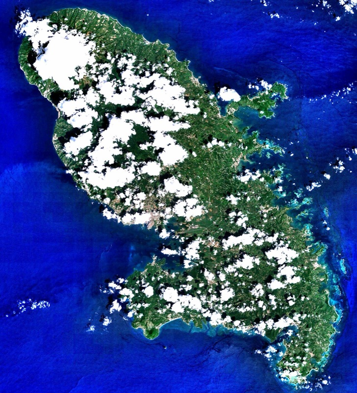

---
id    = "47bf6661-e0e9-5f62-88d3-331929e72028"
model = "Basic"
tags  = ["caribbean", "north_america", "map"]
---

## Front

What is highlighted on this map?

## Back

<b>Martinique</b>

## Extra

<i>Photo: Unknown author, Public domain, via Wikimedia Commons</i>

About 350,000 people (January 2024) on 1,128 km² Highest point Mount Pelée

It lies directly north of Saint Lucia and south of Dominica. Its name is thought to be a corruption of Madinina, 'island of flowers'.

Overseas department of France.

<a href="https://en.wikipedia.org/wiki/Martinique">Martinique on Wikipedia</a>
