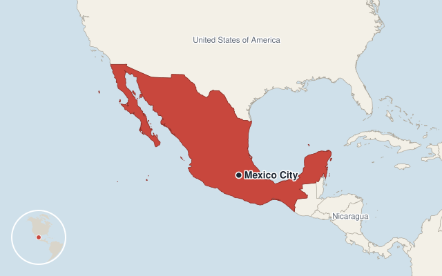
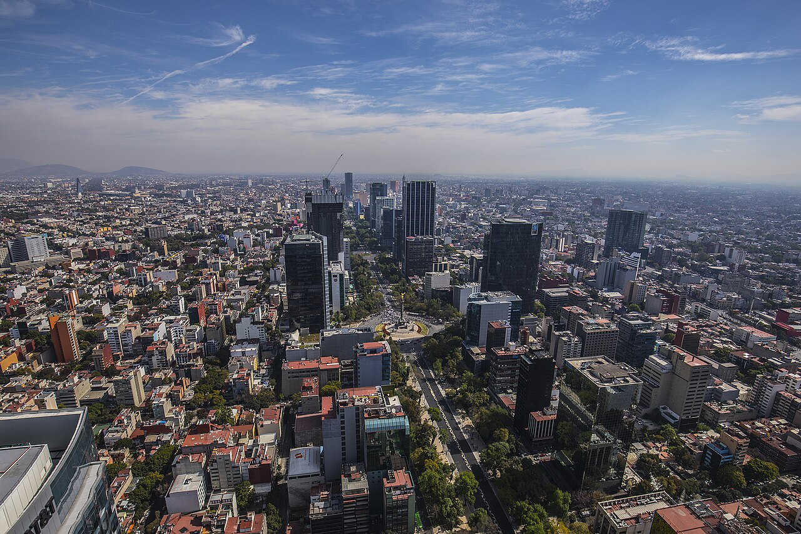

---
id    = "0262a8b8-b757-5f45-ae95-d2577771204b"
model = "Basic"
tags  = ["north_america", "sovereign_state", "capital"]
---

## Front

What is the capital of <b>Mexico</b>?

## Back

<b>Mexico City</b>

## Extra

<i>Photo: Gobierno CDMX, CC0, via Wikimedia Commons</i>

About 9.2 million people in the city itself (2020 census) 2,240 m up, in the Valley of Mexico

It began around 1325 as Tenochtitlan, the Mexica (Aztec) capital, built on islands in Lake Texcoco. The lake was drained from the 17th century on, and the city now stands on its bed.

<a href="https://en.wikipedia.org/wiki/Mexico_City">Mexico City on Wikipedia</a> <a href="https://en.wikipedia.org/wiki/Mexico">Mexico on Wikipedia</a>
