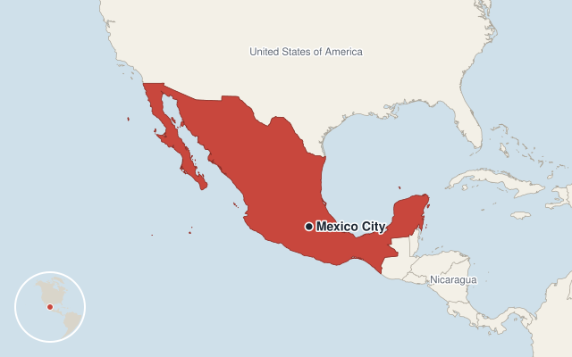

---
id    = "42af7c9e-8436-56cc-a03e-ccb51be8338f"
model = "Basic"
tags  = ["north_america", "sovereign_state", "country"]
---

## Front

<b>Mexico City</b> is the capital of which country or territory?

## Back

<b>Mexico</b>

## Extra

<a href="https://en.wikipedia.org/wiki/Mexico">Mexico on Wikipedia</a> <a href="https://en.wikipedia.org/wiki/Mexico_City">Mexico City on Wikipedia</a>
