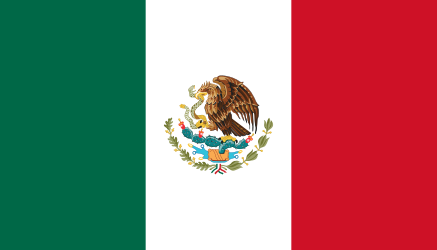
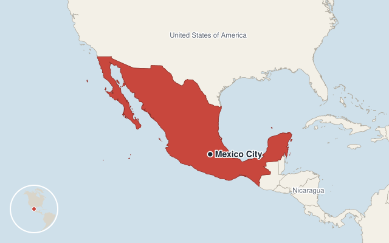

---
id    = "e1080fb1-4a1b-5c4d-a030-68dc7a9bbeb9"
model = "Basic"
tags  = ["north_america", "sovereign_state", "flag"]
---

## Front

Whose flag is this?

## Back

<b>Mexico</b>

## Extra

<a href="https://en.wikipedia.org/wiki/Flag_of_Mexico">Flag of Mexico on Wikipedia</a> <a href="https://en.wikipedia.org/wiki/Mexico">Mexico on Wikipedia</a>
