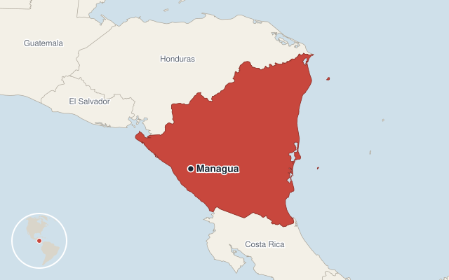

---
id    = "eeff154e-e8e3-540c-97ee-03e8303fbfbd"
model = "Basic"
tags  = ["north_america", "sovereign_state", "capital"]
---

## Front

What is the capital of <b>Nicaragua</b>?

## Back

<b>Managua</b>

## Extra

<a href="https://en.wikipedia.org/wiki/Managua">Managua on Wikipedia</a> <a href="https://en.wikipedia.org/wiki/Nicaragua">Nicaragua on Wikipedia</a>
