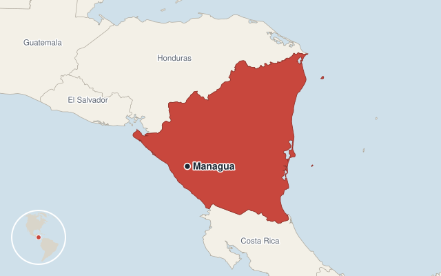

---
id    = "d491f6a6-17ca-5c2f-809d-e091d9b2199d"
model = "Basic"
tags  = ["north_america", "sovereign_state", "country"]
---

## Front

<b>Managua</b> is the capital of which country or territory?

## Back

<b>Nicaragua</b>

## Extra

<a href="https://en.wikipedia.org/wiki/Nicaragua">Nicaragua on Wikipedia</a> <a href="https://en.wikipedia.org/wiki/Managua">Managua on Wikipedia</a>
