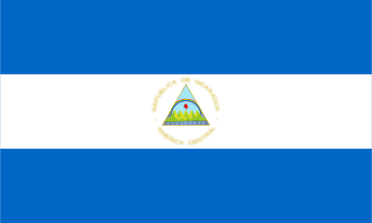

---
id    = "2650fee1-eeb9-50c9-b770-15374fb9d7b5"
model = "Basic"
tags  = ["north_america", "sovereign_state", "flag"]
---

## Front

Whose flag is this?

## Back

<b>Nicaragua</b>

## Extra

Similar flags: El Salvador (different coat of arms, slightly darker blue)
