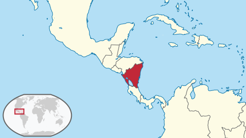
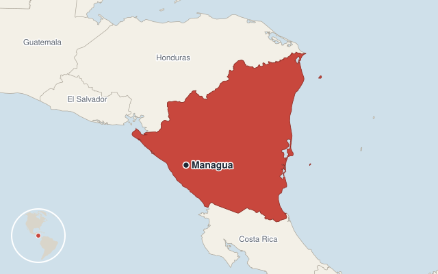

---
id    = "6dbca4f4-9571-5a94-83af-b4eb78feb22a"
model = "Basic"
tags  = ["north_america", "sovereign_state", "map"]
---

## Front

What is highlighted on this map?

## Back

<b>Nicaragua</b>

## Extra

<a href="https://en.wikipedia.org/wiki/Nicaragua">Nicaragua on Wikipedia</a>
