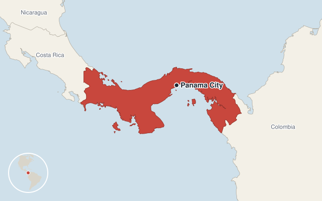

---
id    = "50e96d52-4923-573d-9605-36730b85826b"
model = "Basic"
tags  = ["north_america", "sovereign_state", "capital"]
---

## Front

What is the capital of <b>Panama</b>?

## Back

<b>Panama City</b>

## Extra

Founded on 15 August 1519 At the Pacific entrance of the Panama Canal

Founded by the Spanish conquistador Pedro Arias Dávila. Its metropolitan area is home to nearly half of the country's inhabitants.

<a href="https://en.wikipedia.org/wiki/Panama_City">Panama City on Wikipedia</a> <a href="https://en.wikipedia.org/wiki/Panama">Panama on Wikipedia</a>
