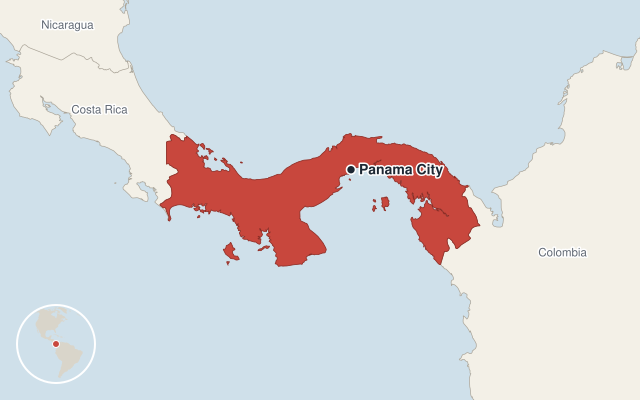

---
id    = "54357ab6-7b6e-5ba9-ba8e-c227edaa7e22"
model = "Basic"
tags  = ["north_america", "sovereign_state", "country"]
---

## Front

<b>Panama City</b> is the capital of which country or territory?

## Back

<b>Panama</b>

## Extra

<a href="https://en.wikipedia.org/wiki/Panama">Panama on Wikipedia</a> <a href="https://en.wikipedia.org/wiki/Panama_City">Panama City on Wikipedia</a>
