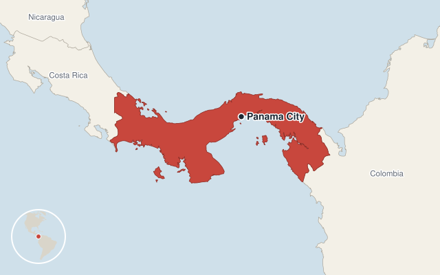

---
id    = "2511fdda-a01a-58d9-847c-f7f52a667256"
model = "Basic"
tags  = ["north_america", "sovereign_state", "flag"]
---

## Front

Whose flag is this?

## Back

<b>Panama</b>

## Extra

Officially adopted by law in 1925

Made by María de la Ossa de Amador. Flag Day is 4 November, the day after the separation from Colombia. The stars and quarters are said to stand for the rival political parties, the white for the peace in which they operate.

<a href="https://en.wikipedia.org/wiki/Flag_of_Panama">Flag of Panama on Wikipedia</a> <a href="https://en.wikipedia.org/wiki/Panama">Panama on Wikipedia</a>
