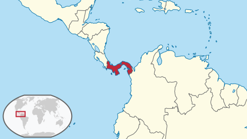
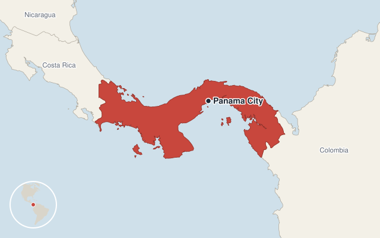

---
id    = "96295b49-64d5-5e86-aef7-7e5aa0a2e458"
model = "Basic"
tags  = ["north_america", "sovereign_state", "map"]
---

## Front

What is highlighted on this map?

## Back

<b>Panama</b>

## Extra

<a href="https://en.wikipedia.org/wiki/Panama">Panama on Wikipedia</a>
