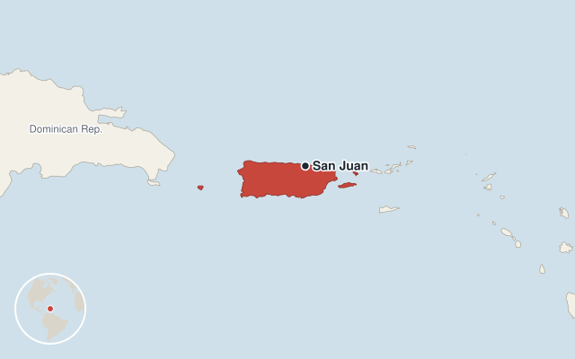

---
id    = "9fe0d89c-4f29-50f7-bb58-ffb46c36fbf0"
model = "Basic"
tags  = ["caribbean", "north_america", "capital"]
---

## Front

What is the capital of <b>Puerto Rico</b>?

## Back

<b>San Juan</b>

## Extra

About 342,000 people (2020 census) Old San Juan holds Fort San Felipe del Morro and Fort San Cristóbal

The Spanish called it Ciudad de Puerto Rico, 'Rich Port City'. It is the second oldest European-established capital in the Americas, after Santo Domingo.

Unincorporated territory of the United States.

<a href="https://en.wikipedia.org/wiki/San_Juan,_Puerto_Rico">San Juan, Puerto Rico on Wikipedia</a> <a href="https://en.wikipedia.org/wiki/Puerto_Rico">Puerto Rico on Wikipedia</a>
