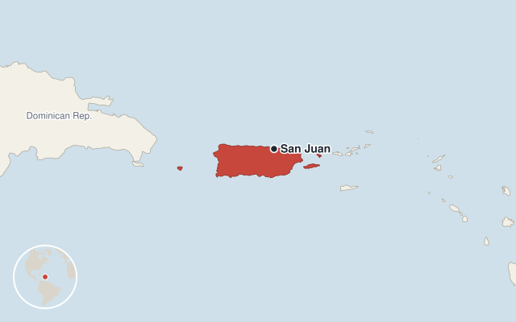

---
id    = "0ee32929-fa70-501f-8076-c777a064ca42"
model = "Basic"
tags  = ["caribbean", "north_america", "country"]
---

## Front

<b>San Juan</b> is the capital of which country or territory?

## Back

<b>Puerto Rico</b>

## Extra

About 3.3 million people (2020 census) in 9,104 km²

A self-governing archipelago organized as an unincorporated territory of the United States, with the status of commonwealth. Spanish and English are its official languages.

Unincorporated territory of the United States.

<a href="https://en.wikipedia.org/wiki/Puerto_Rico">Puerto Rico on Wikipedia</a> <a href="https://en.wikipedia.org/wiki/San_Juan,_Puerto_Rico">San Juan, Puerto Rico on Wikipedia</a>
