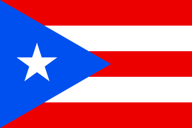
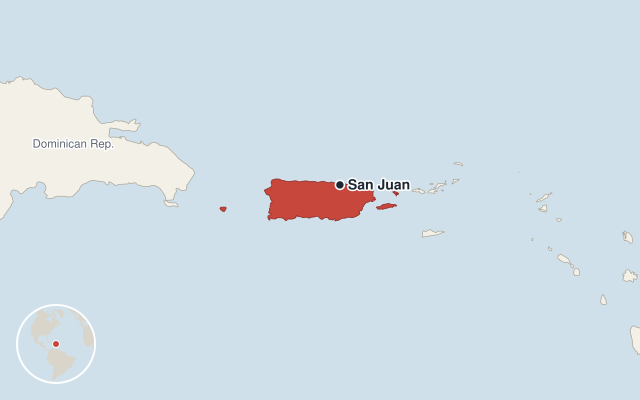

---
id    = "a83978a9-4529-5489-82d2-0103df87e20f"
model = "Basic"
tags  = ["caribbean", "north_america", "flag"]
---

## Front

Whose flag is this?

## Back

<b>Puerto Rico</b>

## Extra

Similar flags: Cuba (red triangle, blue stripes)  Unincorporated territory of the United States.

<a href="https://en.wikipedia.org/wiki/Flag_of_Puerto_Rico">Flag of Puerto Rico on Wikipedia</a> <a href="https://en.wikipedia.org/wiki/Puerto_Rico">Puerto Rico on Wikipedia</a>
